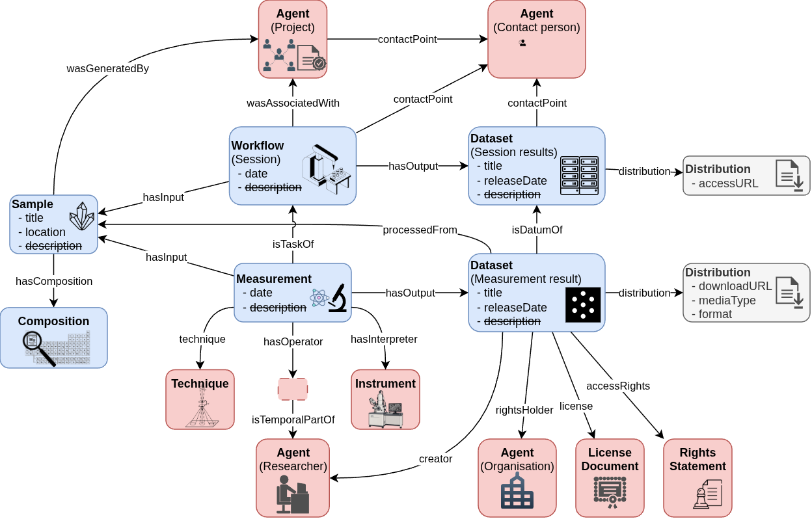
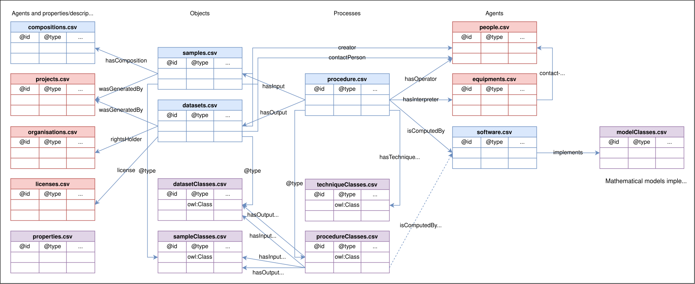

PhysMet Data Documentation Templates
====================================
The objective of this repository is to share templates and recommended
folder structures to store data in the frame of the SFI PhysMet.

Documenting characterisation and modelling results
--------------------------------------------------

### Characterisation results
Characterisation results are represented according to the figure below:

> **Figure**. Representing characterisation data.

Templates and shared resources
------------------------------
The [templates/](templates/) folder contain a set of CSV templates for documentation of scientific data.
To increase the richness and FAIRness or the metadata, the documented data should be related to other shared resources.
These shared resources can be found in the CSV files in the [shared/](shared/) folder.

The figure below shows how the templates and shared resources are related to each other.

> **Figure**. Overview of template tables and how they relate to each other.
>
> The colour coding is as follows; red: shared resources reused between
> projects, blue: tables created by the individual data producer (not
> all tables are needed by everyone); violet: templates for new
> classes and properties.

Each row in a CSV template documents an individual, class or property that will be added to the knowledge base.
The templates can be grouped into three categories:

Shared resources (maintained at Centre-level):
- **[equipment.csv](shared/equipment.csv)**: Equipment for materials processing, characterisation instruments, etc.
- **[techniques.csv](shared/techniques.csv)**: Characterisation techniques (documented as classes)
- **[people.csv](shared/people.csv)**: People. May be a contact point for a sample, dataset or equipment or the operator of a process.
- **[software.csv](shared/software.csv)**: Software used for driving a process.
- **[projects.csv](shared/projects.csv)**: Projects. May e.g. be referred to as the creator of a sample or dataset.
- **[organisations.csv](shared/organisations.csv)**: Organisations. May e.g. be referred to as the owner of a dataset.
- **[licenses.csv](shared/licenses.csv)**: Licenses used in SFI PhysMet.

Individuals documented by the user:
- **[datasets.csv](templates/datasets.csv)**: Datasets. What the dataset is about, how can it be accessed and (optionally) what it contain how it is structured.
- **[samples.csv](templates/samples.csv)**: Physical samples (material objects) that are processed and characterised.
- **[processes.csv](templates/processes.csv)**: Processes and procedures. Includes materials processing, characterisation and computations. Has samples/datasets as input and output.
- **[composition.csv](templates/composition.csv)**: Chemical composition of a sample. This table has a custom and user-friendly format. It must be parsed with the [compositions] tool.

Class-level documentation - generalised input provided by the user:
- **[datasetClasses.csv](templates/datasetClasses.csv)**: Dataset classes, like the general concept of a TEM bright field image. An actual TEM bright field image would be an instance of this class.
- **[sampleClasses.csv](templates/sampleClasses.csv)**: Sample classes, like TEM sample. An actual TEM sample would be an instance of this class.
- **[processClasses.csv](templates/processClasses.csv)**: Process classes, like TEM bright field imaging. Has class-level samples/datasets as input and output.
- **[properties.csv](templates/properties.csv)**: For user-defined annotations, data properties or object properties.

### Column headers
The default keywords that can be used in column headers are summarised in [headers.csv](headers.csv).

TODO: Describe how to extend this list.

### Prefixes
See section [identifiers](#identifiers) below for an introduction.

A list of all default prefixes can be found in [prefixes.csv](shared/prefixes.csv).

Identifiers
-----------
Everything in the knowledge base should have a globally unique and persistent identifier.
In the context of the knowledge base we call these IDs for *International Resource Identifiers* (IRIs).

Furthermore, it is considered a [good practice](https://faircookbook.elixir-europe.org/content/recipes/findability/identifiers.html#generating-resolvable-urls) for FAIR data that IRIs are resolvable.

How SFI PhysMet address these requirements on IRIs:
- **Globally uniqueness** is ensured by the use of namespaces that we own.
- **Persistence** means that identifiers, once given, should never be changed.
- **Resolvability** this will be addressed by redirections to ensure persistence even if the documented resource is moved.

For example, a SEM dataset by Andreas Voll Bugten may be identified by the IRI
https://orcid.org/0000-0003-0311-8584/JP16/SEM/220406aa/nitride5.tif
where https://orcid.org/0000-0003-0311-8584/ is a unique prefix for all data and other resources related to Andreas.

This namespace can be abbreviated with a prefix.
Each person, project and organisation has a prefix assigned to them, which is unique within the scope of our knowledge base.

For example, we have assigned the prefix "avb" to Andreas Voll Bugten.
When documenting the above dataset, we will refer to it with the following IRI:
`abd:JP16/SEM/220406aa/nitride5.tif`.

Samples coming from Elkem, should use the Elkem prefix, and so forth.

> [!NOTE]
> An IRI written with a prefix, like `abd:JP16/SEM/220406aa/nitride5.tif`, is called a [CURIE] (compact URI).
> A CURIE differ from a [QName] in that the part following the colon may contain embedded slashes.

The prefixes are maintained in the three global tables:
- people.csv
- projects.csv
- organisations.csv

Documenting a folder structure with characterisation or modelling results
-------------------------------------------------------------------------
You can use [Treeweaver](docs/treeweaver.md) for documenting a large folder structure with results.

Documenting workflows
---------------------
Workflows are documented as a set of processes with objects (samples/datasets) as input or output.

Workflows can both be documented at individual-level (for provenance) or at a class-level (to describe a reusable workflow that might or might not yet have been executed).

> Figure 2. General individual-level workflow.

[CURIE]: https://www.w3.org/2001/sw/BestPractices/HTML/2005-10-27-CURIE
[Qname]: https://en.wikipedia.org/wiki/QName
[compositions]: https://github.com/SINTEF/physmet-data-documentation-templates/blob/main/docs/tools.md#compositions
